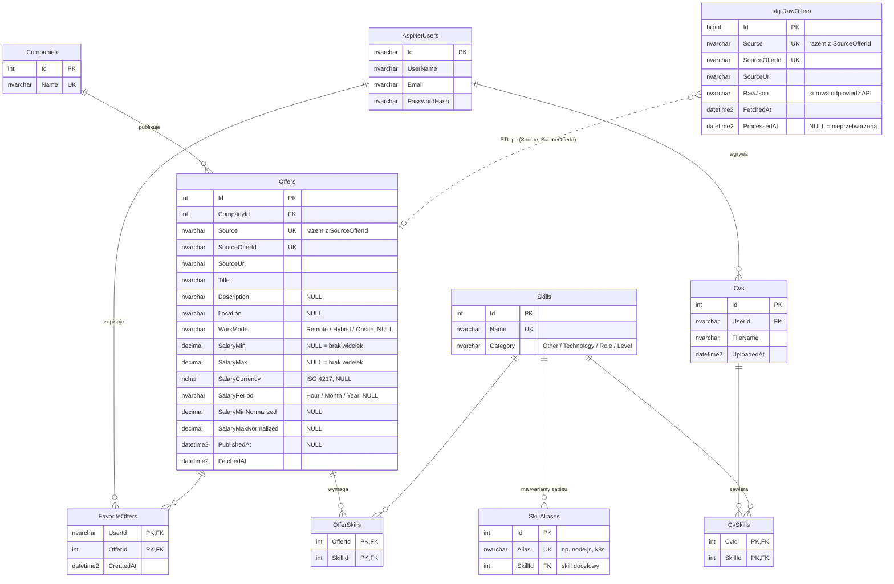

# Schemat bazy danych RynekIT

Diagram aktualny dla migracji `AddSkillCategoryAndAliases`. Tabele ASP.NET Core Identity pominięte, poza `AspNetUsers`.



## Zasady modelu

### Pochodzenie ofert

- `Source` to identyfikator źródła, np. `remoteok`, `himalayas`.
- `SourceOfferId` to identyfikator oferty w serwisie źródłowym. Unikalny jest dopiero w parze z `Source`, bo różne serwisy mogą używać tych samych identyfikatorów.
- `SourceUrl` to link do oryginalnego ogłoszenia. Jest wymagany, bo warunki API Remote OK wymagają linku do oryginału.

### Wynagrodzenie

- `SalaryMin` i `SalaryMax` przechowują wartości dokładnie tak, jak w ogłoszeniu. `NULL` oznacza brak widełek; nigdy nie zapisujemy `0`.
- `SalaryCurrency` to kod waluty ISO 4217, np. `PLN`, `USD`.
- `SalaryMinNormalized` i `SalaryMaxNormalized` są wypełniane przy przenoszeniu danych ze `stg.RawOffers` do `Offers`, po przeliczeniu na jedną walutę i jeden okres. Docelowe jednostki są do ustalenia.
- Check constraints `CK_Offers_SalaryRange` i `CK_Offers_SalaryNormalizedRange` pilnują, żeby minimum nie było większe od maksimum.

### Pozostałe

- `WorkMode` i `SalaryPeriod` są zapisywane jako tekst, żeby zapytania SQL były czytelne.
- Usunięcie firmy nie usuwa jej ofert (`DeleteBehavior.Restrict`).
- `Skills` to wspólny słownik dla ofert i CV, więc dopasowanie CV do oferty to złączenie po `SkillId`.
- Konta użytkowników obsługuje ASP.NET Core Identity (`AppUser : IdentityUser`). Aplikacja nie przechowuje haseł samodzielnie, tylko ich skróty.
- Kolumny z datą utworzenia (`Offers.FetchedAt`, `RawOffers.FetchedAt`, `Cvs.UploadedAt`, `FavoriteOffers.CreatedAt`) mają domyślną wartość `SYSUTCDATETIME()`.

### Słownik technologii i aliasy

- `Skills.Category` to enum zapisany jako tekst (`nvarchar(20)`), z wartościami `Other`, `Technology`, `Role`, `Level`. Domyślna wartość to `Other`.
- Migracja `AddSkillCategoryAndAliases` zakłada słownik znanych skilli z kategoriami. Tagi spoza słownika dostają kategorię `Other`.
- `SkillAliases` mapuje wariant zapisu (np. `node.js`, `nodejs`, `k8s`) na skill docelowy (`node`, `kubernetes`). `Alias` jest unikalny, a usunięcie skilla usuwa jego aliasy.
- Nazwy skilli i aliasów zapisujemy małymi literami, bez spacji na początku i końcu, maksymalnie 100 znaków (tak samo normalizuje je ETL).

Przepływ tagu z Remote OK do słownika:

1. Scraper zapisuje ofertę z tagami do `stg.RawOffers`.
2. `stg.usp_ProcessRawOffers` normalizuje każdy tag (`LOWER`, `TRIM`, obcięcie do 100 znaków) i jeśli tag jest aliasem, zamienia go na nazwę skilla docelowego.
3. Tag, którego nie ma w `Skills`, trafia do słownika jako nowy skill z kategorią `Other`.
4. W każdym przebiegu ETL `dbo.usp_MergeSkillAliases` scala duplikaty: skill, którego nazwa jest aliasem innego skilla, oddaje swoje powiązania z ofertami i CV skillowi docelowemu i jest usuwany. Dzięki temu alias dodany później (np. `vue.js` → `vue` przy istniejącym skillu `vue.js`) zostanie scalony przy następnym uruchomieniu ETL. Łańcuch aliasów (alias wskazuje na skill, który sam jest duplikatem) jest rozwiązywany do skilla końcowego. Cykl aliasów (np. `a` → `b` i `b` → `a`) kończy procedurę błędem 50001 i wymaga ręcznej poprawki `SkillAliases`.

Scalenie duplikatów jest nieodwracalne: cofnięcie migracji nie przywróci usuniętych skilli ani ich pierwotnych powiązań.

## Kontrakt scrapera ze `stg.RawOffers`

Scraper zapisuje surowe dane tylko do `stg.RawOffers`. Para `(Source, SourceOfferId)` jest unikalna, więc ta sama oferta pobrana ponownie musi zaktualizować istniejący wiersz, a nie wstawić nowy. Zwykły `INSERT` zakończy się błędem duplikatu.

Przy ponownym pobraniu scraper nadpisuje `RawJson` i `FetchedAt` oraz ustawia `ProcessedAt = NULL`, żeby ETL przetworzył ofertę jeszcze raz:

```sql
MERGE stg.RawOffers AS t
USING (VALUES (@Source, @SourceOfferId, @SourceUrl, @RawJson))
    AS s (Source, SourceOfferId, SourceUrl, RawJson)
ON t.Source = s.Source AND t.SourceOfferId = s.SourceOfferId
WHEN MATCHED THEN
    UPDATE SET SourceUrl = s.SourceUrl, RawJson = s.RawJson,
               FetchedAt = SYSUTCDATETIME(), ProcessedAt = NULL
WHEN NOT MATCHED THEN
    INSERT (Source, SourceOfferId, SourceUrl, RawJson)
    VALUES (s.Source, s.SourceOfferId, s.SourceUrl, s.RawJson);
```

Kolumna `ProcessedAt` z wartością `NULL` oznacza ofertę, której ETL jeszcze nie przeniósł do `Offers`. Długości kolumn (`Source` 50, `SourceOfferId` 100, `SourceUrl` 500) trzeba zweryfikować na danych z pierwszego zaimplementowanego źródła.