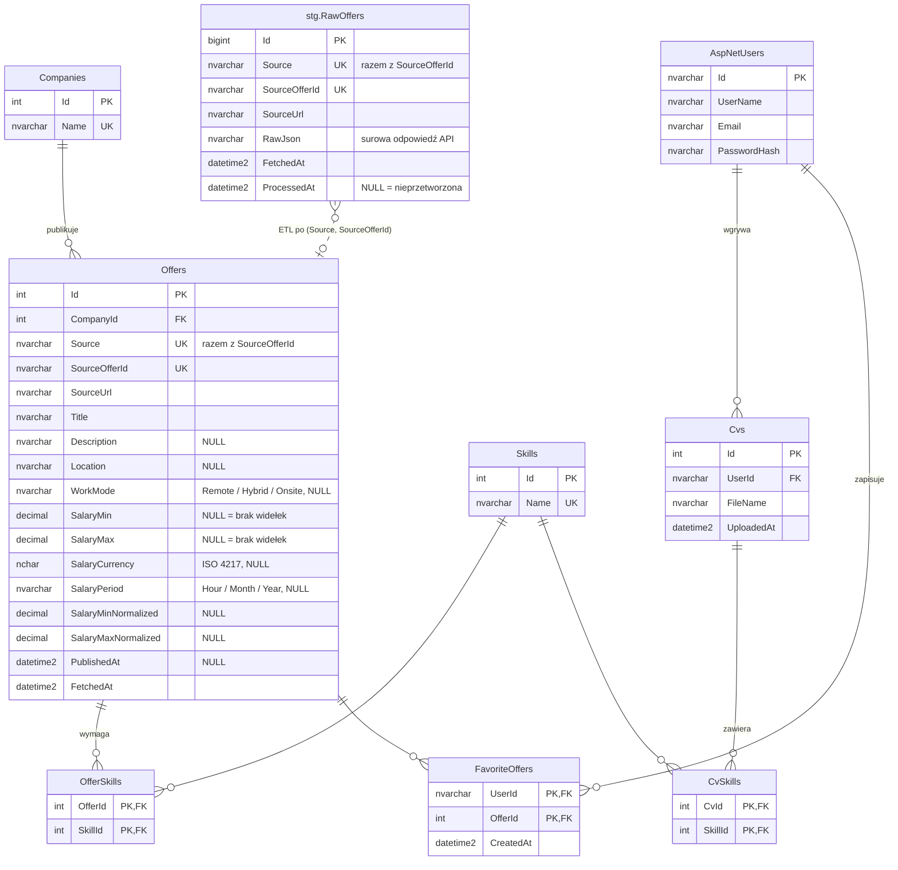

# Schemat bazy danych RynekIT

Diagram aktualny dla migracji `SalaryChecksAndFetchedAtDefault`. Tabele ASP.NET Core Identity pominięte, poza `AspNetUsers`.



## Zasady modelu

### Pochodzenie ofert

- `Source` to identyfikator źródła, np. `remoteok`, `himalayas`.
- `SourceOfferId` to identyfikator oferty w serwisie źródłowym. Unikalny jest dopiero w parze z `Source`, bo różne serwisy mogą używać tych samych identyfikatorów.
- `SourceUrl` to link do oryginalnego ogłoszenia. Jest wymagany, bo warunki API Remote OK wymagają linku do oryginału.

### Wynagrodzenie

- `SalaryMin` i `SalaryMax` przechowują wartości dokładnie tak, jak w ogłoszeniu. `NULL` oznacza brak widełek; nigdy nie zapisujemy `0`.
- `SalaryCurrency` to kod waluty ISO 4217, np. `PLN`, `USD`.
- `SalaryMinNormalized` i `SalaryMaxNormalized` są wypełniane przy przenoszeniu danych ze `stg.RawOffers` do `Offers`, po przeliczeniu na jedną walutę i jeden okres. Docelowe jednostki są do ustalenia.
- Check constraints `CK_Offers_SalaryRange` i `CK_Offers_SalaryNormalizedRange` pilnują, żeby minimum nie było większe od maksimum.

### Pozostałe

- `WorkMode` i `SalaryPeriod` są zapisywane jako tekst, żeby zapytania SQL były czytelne.
- Usunięcie firmy nie usuwa jej ofert (`DeleteBehavior.Restrict`).
- `Skills` to wspólny słownik dla ofert i CV, więc dopasowanie CV do oferty to złączenie po `SkillId`.
- Konta użytkowników obsługuje ASP.NET Core Identity (`AppUser : IdentityUser`). Aplikacja nie przechowuje haseł samodzielnie, tylko ich skróty.
- Kolumny z datą utworzenia (`Offers.FetchedAt`, `RawOffers.FetchedAt`, `Cvs.UploadedAt`, `FavoriteOffers.CreatedAt`) mają domyślną wartość `SYSUTCDATETIME()`.

## Kontrakt scrapera ze `stg.RawOffers`

Scraper zapisuje surowe dane tylko do `stg.RawOffers`. Para `(Source, SourceOfferId)` jest unikalna, więc ta sama oferta pobrana ponownie musi zaktualizować istniejący wiersz, a nie wstawić nowy. Zwykły `INSERT` zakończy się błędem duplikatu.

Przy ponownym pobraniu scraper nadpisuje `RawJson` i `FetchedAt` oraz ustawia `ProcessedAt = NULL`, żeby ETL przetworzył ofertę jeszcze raz:

```sql
MERGE stg.RawOffers AS t
USING (VALUES (@Source, @SourceOfferId, @SourceUrl, @RawJson))
    AS s (Source, SourceOfferId, SourceUrl, RawJson)
ON t.Source = s.Source AND t.SourceOfferId = s.SourceOfferId
WHEN MATCHED THEN
    UPDATE SET SourceUrl = s.SourceUrl, RawJson = s.RawJson,
               FetchedAt = SYSUTCDATETIME(), ProcessedAt = NULL
WHEN NOT MATCHED THEN
    INSERT (Source, SourceOfferId, SourceUrl, RawJson)
    VALUES (s.Source, s.SourceOfferId, s.SourceUrl, s.RawJson);
```

Kolumna `ProcessedAt` z wartością `NULL` oznacza ofertę, której ETL jeszcze nie przeniósł do `Offers`. Długości kolumn (`Source` 50, `SourceOfferId` 100, `SourceUrl` 500) trzeba zweryfikować na danych z pierwszego zaimplementowanego źródła.